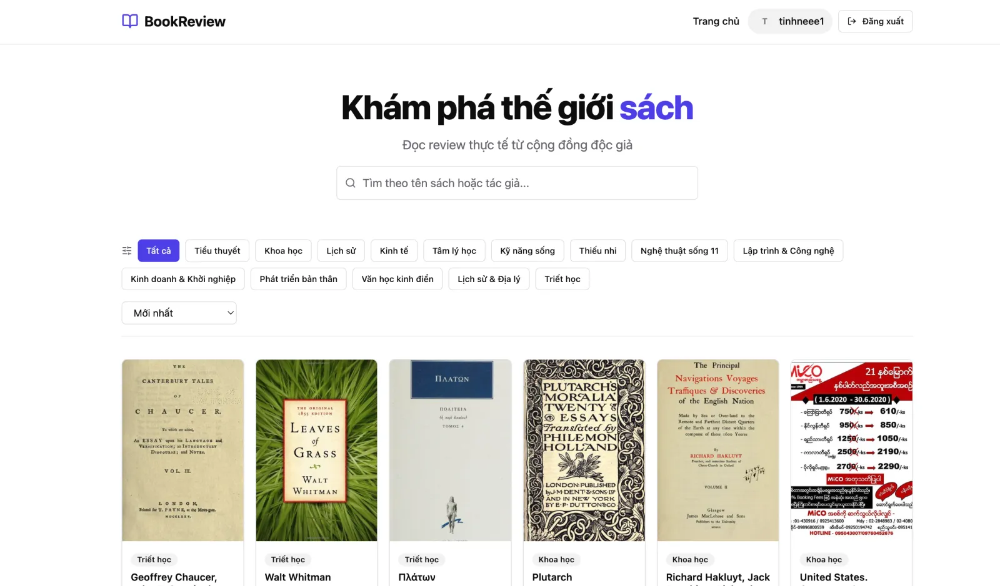
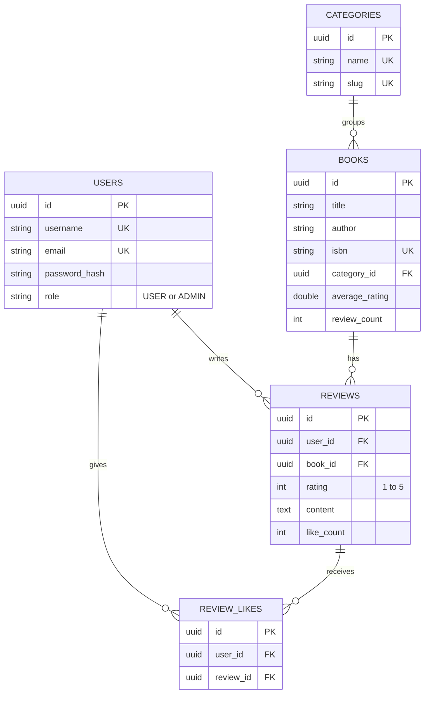

# Book Review API

REST API for a community book-review site. Readers browse and search a catalogue, post one star-rated review per book, and like other people's reviews. Admins manage books and categories. Built with Spring Boot, Spring Security (JWT) and PostgreSQL.


**Live demo:** [book-review-frontend-eta.vercel.app](https://book-review-frontend-eta.vercel.app) · **API:** `https://bookreview-api-x5yd.onrender.com` (Render free tier, so the first request after idle can take 30–60 s)

**Frontend:** [tinhne/book-review-frontend](https://github.com/tinhne/book-review-frontend) (React + Vite client for this API)



## Overview

The API backs a Vietnamese-language book-review web app. It covers the usual community-review flow: register and log in with JWT, browse a paginated and searchable book list, read reviews, write and edit your own review, and toggle likes on others. Each book's average rating and review count are recalculated from the database whenever a review changes.

## Key features

- **Stateless JWT auth** – register and login return a signed HS256 token (jjwt 0.12). `JwtAuthFilter` validates `Authorization: Bearer <token>` on every request. Passwords are hashed with BCrypt (strength 12).
- **Role-based access** – public `GET` routes for books, categories and reviews. Book and category writes are restricted with `@PreAuthorize("hasRole('ADMIN')")`.
- **Server-side pagination, search and filter** – `GET /api/books` supports `page`, `size` (max 50), case-insensitive search on title or author, `categoryId` filtering and sorting. The list query uses `LEFT JOIN FETCH` on category to avoid N+1 queries.
- **Reviews with rating and text** – one review per user per book (database unique constraint `uq_user_book_review`), rating 1–5, content 10–5000 characters. Only the author can edit or delete a review.
- **Toggle like** – `POST /api/reviews/{id}/like` likes or unlikes. Self-likes are rejected, and a unique constraint prevents duplicate likes. Review lists include `likedByCurrentUser`, resolved for the whole page with a single query.
- **Consistent book stats** – create, update and delete of a review run in one `@Transactional` method that also recalculates `averageRating` and `reviewCount` with aggregate queries.
- **Validation and error handling** – Bean Validation on request DTOs. `GlobalExceptionHandler` maps errors to `{ "code", "message" }` with `400`, `403`, `404` or `500`.
- **CORS** – allows `localhost:5173`, `localhost:3000`, `*.vercel.app` and `*.onrender.com`.
- **Startup seeding** – `DataSeeder` creates seven default categories and, when `ADMIN_PASSWORD` is set, an `admin` account if they are missing.
- **Health endpoint** – `GET /api/health`, used by the frontend to wake the server after idle.

## Tech stack

| Layer | Technology |
| --- | --- |
| Language / runtime | Java 21 |
| Framework | Spring Boot 3.2.5 (Web, Security, Data JPA, Validation) |
| Auth | Spring Security, jjwt 0.12.6, BCrypt |
| Database | PostgreSQL (`postgres:15-alpine` in `docker-compose.yml`), Hibernate `ddl-auto` |
| Build | Maven Wrapper (Maven 3.9.14), Lombok |
| Deployment | Multi-stage Dockerfile (Maven 3.9.6 build, Temurin 21 JRE runtime), Render |

## Architecture

Requests flow through a standard layered design:

`JwtAuthFilter` → `controller/` → `service/` (business rules, `@Transactional`) → `repository/` (Spring Data JPA with JPQL) → PostgreSQL

Request and response DTOs live in `dto/request` and `dto/response`, so entities never leave the service layer.



Unique constraints: `(user_id, book_id)` on reviews and `(user_id, review_id)` on review likes.

## Project structure

```text
book_review/
├── src/main/java/com/bookapp/book_review/
│   ├── config/          # DataSeeder (admin account + default categories)
│   ├── controller/      # Auth, Book, Category, Review, User, Health
│   ├── dto/             # request/ and response/ DTOs (Lombok)
│   ├── entity/          # User, Book, Category, Review, ReviewLike
│   ├── exception/       # domain exceptions + GlobalExceptionHandler
│   ├── repository/      # Spring Data JPA repositories (JPQL filters, aggregates)
│   ├── security/        # SecurityConfig, JwtAuthFilter, JwtUtil, UserDetailsServiceImpl
│   └── service/         # business logic
├── src/main/resources/application.yaml
├── http/                # IntelliJ HTTP Client request collections
├── docker-compose.yml   # local PostgreSQL
├── Dockerfile           # production image
└── .env.example         # environment variable template
```

## Getting started

### Prerequisites

- JDK 21
- Docker (for the local database)

### 1. Start PostgreSQL

```bash
docker compose up -d
```

This starts PostgreSQL on **localhost:5436** with database `bookreview`. The credentials are in `docker-compose.yml`.

### 2. Configure environment variables

```bash
cp .env.example .env
# edit .env: database credentials and a JWT secret
openssl rand -base64 32   # generates a suitable JWT_SECRET
```

Spring Boot does not read `.env` by itself, so export it into your shell:

```bash
set -a; source .env; set +a
```

### 3. Run the API

```bash
./mvnw spring-boot:run
```

The API listens on `http://localhost:8080`. Tables are created by Hibernate (`DDL_AUTO=update`). On first start, `DataSeeder` creates the default categories. If `ADMIN_PASSWORD` is set, it also creates an `admin` user with that password; otherwise admin seeding is skipped with a warning.

### Build and test

```bash
./mvnw clean package            # build the jar (runs tests)
./mvnw clean package -DskipTests
./mvnw test                     # context-load test; needs the database env vars
```

## Environment variables

| Name | Required | Description |
| --- | --- | --- |
| `DATABASE_URL` | Yes | JDBC URL, e.g. `jdbc:postgresql://localhost:5436/bookreview` |
| `DATABASE_USERNAME` | Yes | Database user |
| `DATABASE_PASSWORD` | Yes | Database password |
| `JWT_SECRET` | Yes | Base64-encoded HMAC key (at least 256 bits) used to sign tokens |
| `JWT_EXPIRATION` | No | Token lifetime in milliseconds. Default `86400000` (24 h) |
| `DDL_AUTO` | No | Hibernate schema mode. Default `update` |
| `ADMIN_PASSWORD` | No | Password for the seeded `admin` account. If unset, no admin account is created |
| `PORT` | No | HTTP port. Default `8080` |

## API reference

Base path `/api`. **Auth:** *Public* needs no token. *User* needs `Authorization: Bearer <token>`. *Admin* needs a token for a user with role `ADMIN`.

### Auth and users

| Method | Path | Auth | Description |
| --- | --- | --- | --- |
| POST | `/api/auth/register` | Public | Create an account (`username`, `email`, `password`). Returns `201` with `{ token, tokenType, user }` |
| POST | `/api/auth/login` | Public | Log in with `username` and `password`. Returns `{ token, tokenType, user }` |
| GET | `/api/users/me` | User | Current user's profile |

### Books

| Method | Path | Auth | Description |
| --- | --- | --- | --- |
| GET | `/api/books` | Public | Paginated list. Query: `page` (0), `size` (10, max 50), `search` (title or author), `categoryId`, `sortBy` (`createdAt`), `sortDir` (`asc`/`desc`) |
| GET | `/api/books/{id}` | Public | Book detail with category, average rating and review count |
| POST | `/api/books` | Admin | Create a book (`title`, `author`, `isbn`, `description`, `coverUrl`, `categoryId`). Returns `201` |
| PUT | `/api/books/{id}` | Admin | Partial update. Only non-blank fields are applied |
| DELETE | `/api/books/{id}` | Admin | Delete a book. Returns `204` |

### Categories

| Method | Path | Auth | Description |
| --- | --- | --- | --- |
| GET | `/api/categories` | Public | All categories (`id`, `name`, `slug`) |
| POST | `/api/categories` | Admin | Create a category from `name`. The slug is generated. Returns `201` |
| DELETE | `/api/categories/{id}` | Admin | Delete a category. Returns `204` |

### Reviews

| Method | Path | Auth | Description |
| --- | --- | --- | --- |
| GET | `/api/reviews/book/{bookId}` | Public (token optional) | Paginated reviews, newest first. Query: `page`, `size`. With a token, each item includes `likedByCurrentUser` |
| POST | `/api/reviews` | User | Create a review (`bookId`, `rating` 1–5, `content` 10–5000 chars). One per user per book |
| PUT | `/api/reviews/{id}` | User (author) | Update `content` and/or `rating` |
| DELETE | `/api/reviews/{id}` | User (author) | Delete the review and its likes. Returns `204` |
| POST | `/api/reviews/{id}/like` | User | Toggle like or unlike. Liking your own review returns `400` |

### Health

| Method | Path | Auth | Description |
| --- | --- | --- | --- |
| GET | `/api/health` | Public | `{ "status": "UP", "service": "book-review" }` |

**Error format**

```json
{ "code": "VALIDATION_ERROR", "message": "Rating min is 1" }
```

Codes: `BAD_REQUEST`, `VALIDATION_ERROR`, `NOT_FOUND`, `FORBIDDEN`, `INTERNAL_SERVER_ERROR`.

### Trying the API with the `.http` files

`http/` contains ready-made request sequences for the IntelliJ HTTP Client. The `> ` blocks store tokens and IDs between requests:

| File | Covers |
| --- | --- |
| `auth.http` | Register, log in, `GET /api/users/me` |
| `category.http` | Admin vs. user permissions on category create and delete (expects `201`, `403`, `404`) |
| `book.http` | Admin book CRUD, search, sorting, category filter |
| `review.http` | Two users: create, update, like, self-like (expects `400`), list with `likedByCurrentUser`, delete |

Each file defines `@baseUrl` (localhost, used by default), `@prodUrl` (the deployed API), and `@adminPassword` / `@userPassword` placeholders. Set the passwords locally before running the requests and do not commit real credentials.

## Deployment

- **API:** built from the `Dockerfile` and deployed on Render at `https://bookreview-api-x5yd.onrender.com` (`GET /api/health` returned `200` on 2026-10-31). A `Procfile` is also included for platforms that run the packaged jar directly.
- **Frontend:** the React client is deployed on Vercel at [book-review-frontend-eta.vercel.app](https://book-review-frontend-eta.vercel.app). See [tinhne/book-review-frontend](https://github.com/tinhne/book-review-frontend).

## Known limitations

- **No admin endpoints yet** – admin response DTOs (`AdminUserResponse`, `AdminReviewResponse`, `DashboardStatsResponse`) and search/count queries exist, but no admin dashboard endpoints use them. Admins cannot delete other users' reviews.
- **Missing token returns `403`, not `401`** – no custom `AuthenticationEntryPoint` is configured.
- **Some bad input returns `500`** – for example an unknown `sortBy` value or a malformed UUID, and the response includes the exception message.
- **Minimal tests** – only a Spring context-load test, which needs a running database.

## Author

**Lê Văn Trung Tính** — Software Engineer | AI Product Builder

- Website: [trungtinh.site](https://trungtinh.site)
- GitHub: [@tinhne](https://github.com/tinhne)
